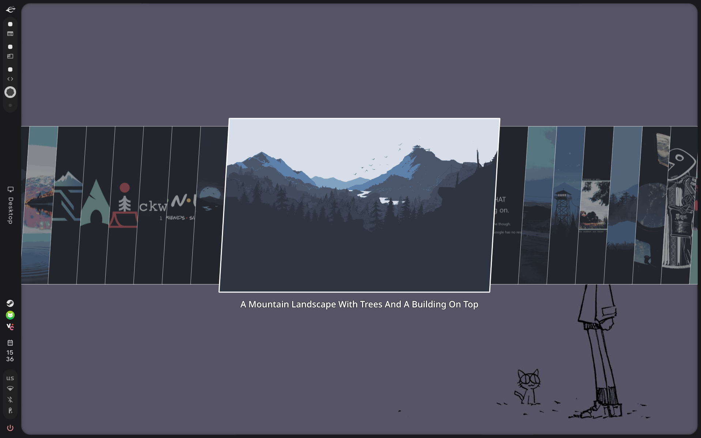

[RU](#ru) | [EN](#en)

---

# English

# Image picker for Quickshell

This is a standalone Quickshell overlay for browsing and applying wallpapers on
Arch Linux. The carousel layout and keyboard navigation are retained; it no
longer requires Omarchy shell components or theme utilities.

## Install

Run `./image-picker/image-picker/install.sh`, then add bind to
your Hyprland configuration 
 `hl.bind("SUPER + CTRL + SPACE", hl.dsp.exec_cmd(
 "qs ipc -c image-picker call image-picker toggle || qs -n -c image-picker"
 ))`. 
Default binding is **Super+Ctrl+Space**.
It toggles the single running picker; if Quickshell is not running, it starts one
instance. Pressing the binding again after closing the picker reopens that same
instance without creating an overlap.

The installer creates `~/.config/image-picker/directories` if it does not
already exist. Put one wallpaper directory per line in that file.

Install a wallpaper backend: `caelestia wallpaper`, `swww`, `hyprpaper`, or `swaybg`. The
apply script uses the first installed backend in that order.
For video previews, install `ffmpegthumbnailer`; static-image browsing does not
require it.

## Run from this checkout

Use `IMAGE_PICKER_HOME="$PWD" qs -p "$PWD/shell.qml"` from this directory so
the picker can locate its listing and apply scripts. `IMAGE_PICKER_DIRS` can
override the configured wallpaper directories with a newline-separated list.

## Controls

- Left/Right, Tab/Shift+Tab: move between images
- Type to filter; Backspace/Delete removes the last filter character
- Enter: apply the selected wallpaper
- Escape: clear the filter, or close the picker
- Click the backdrop: close the picker

---

# Русский

# Выбор обоев для Quickshell

Это автономный оверлей Quickshell для просмотра и применения обоев на
Arch Linux. Компоновка карусели и навигация с клавиатуры сохранены; больше
не требуются компоненты оболочки Omarchy или утилиты тем.

## Установка

Запустите `./image-picker/image-picker/install.sh`, затем добавьте бинд в ваш конфиг Hyprland
`hl.bind("SUPER + CTRL + SPACE", hl.dsp.exec_cmd(
 "qs ipc -c image-picker call image-picker toggle || qs -n -c image-picker"
))`. 
Привязка по умолчанию — **Super+Ctrl+Space**. Она переключает единственный
запущенный экземпляр выбора обоев; если Quickshell не запущен, запускается
один экземпляр. Повторное нажатие привязки после закрытия окна выбора
открывает тот же экземпляр без создания перекрытия.

Установщик создаёт `~/.config/image-picker/directories`, если он ещё не
существует. Укажите по одному каталогу с обоями на строку в этом файле.

Установите бэкенд для обоев: `caelestia wallpaper`, `swww`, `hyprpaper` или `swaybg`.
Скрипт применения использует первый установленный бэкенд в этом порядке.
Для видео-превью установите `ffmpegthumbnailer`; для просмотра статических
изображений он не требуется.

## Запуск из этого репозитория

Используйте `IMAGE_PICKER_HOME="$PWD" qs -p "$PWD/shell.qml"` из этого
каталога, чтобы программа выбора могла найти свои скрипты листинга и
применения. `IMAGE_PICKER_DIRS` может переопределить настроенные каталоги
обоев списком, разделённым переводами строк.

## Управление

- Влево/Вправо, Tab/Shift+Tab: перемещение между изображениями
- Ввод текста для фильтрации; Backspace/Delete удаляет последний символ фильтра
- Enter: применить выбранные обои
- Escape: очистить фильтр или закрыть окно выбора
- Клик по фону: закрыть окно выбора

## Star History

<a href="https://www.star-history.com/?repos=forget-sell%2Fomalike-wallpaper-picker&type=date&legend=top-left">
 <picture>
   <source media="(prefers-color-scheme: dark)" srcset="https://api.star-history.com/chart?repos=forget-sell/omalike-wallpaper-picker&type=date&theme=dark&legend=top-left" />
   <source media="(prefers-color-scheme: light)" srcset="https://api.star-history.com/chart?repos=forget-sell/omalike-wallpaper-picker&type=date&legend=top-left" />
   
 </picture>
</a>
---

# Credits / Благодарности

## English

This project is based on the "image-picker" component from "Omarchy" (https://github.com/omacom/omarchy).

I adapted the original component into a standalone wallpaper picker, removing Omarchy-specific dependencies and adapting it to my own workflow, including integration with Caelestia.

This is an independent project and is not officially affiliated with Omarchy or Caelestia.

The original Omarchy project is licensed under the MIT License. See the original project for its license terms and copyright notices.

## Русский

Этот проект основан на компоненте "image-picker" из "Omarchy" (https://github.com/omacom/omarchy).

Я адаптировал оригинальный компонент в самостоятельный менеджер обоев, убрав зависимости от специфичных для Omarchy компонентов и команд и приспособив его под собственный сценарий использования, включая интеграцию с Caelestia.

Это независимый проект, официально не связанный с Omarchy или Caelestia.

Оригинальный проект Omarchy распространяется под лицензией MIT. Условия лицензии и уведомления об авторских правах см. в оригинальном проекте.
